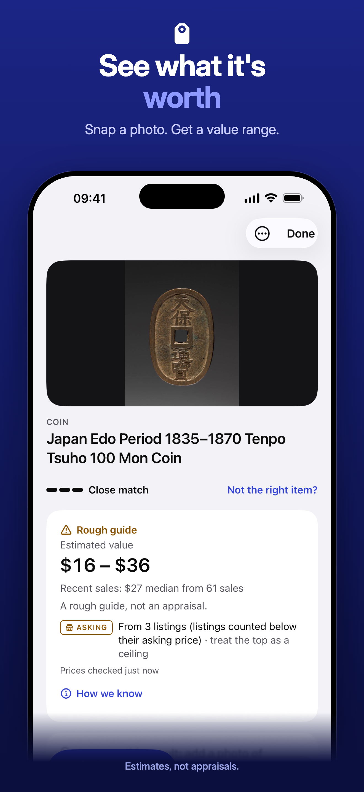
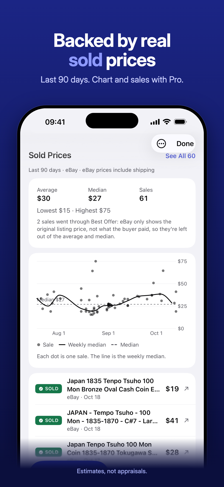
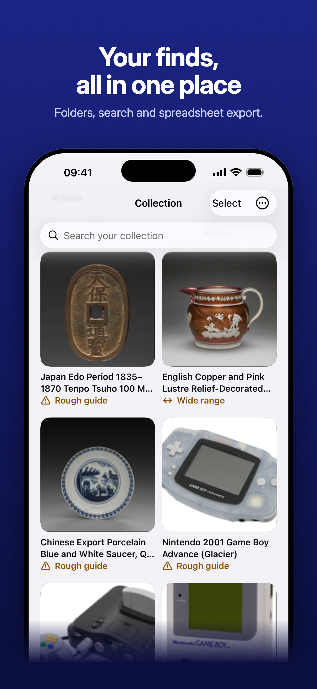
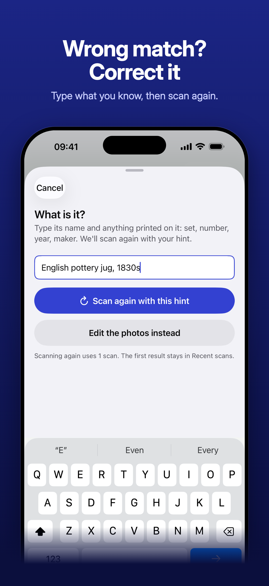
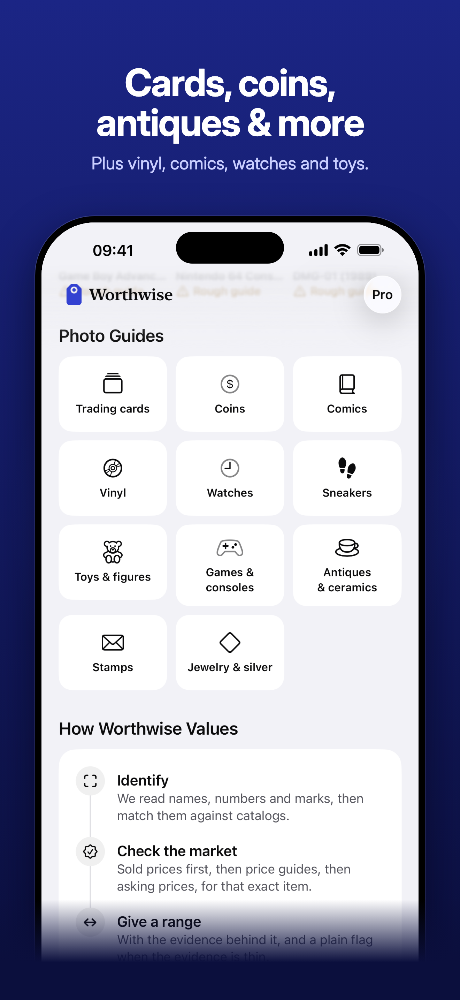
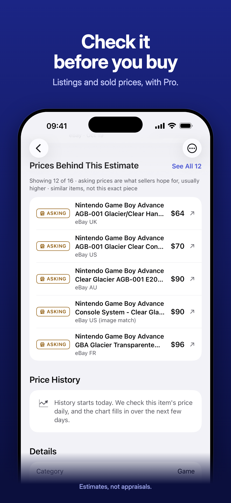

<p align="center">
  
</p>

<h1 align="center">Worthwise: Collectible Scanner</h1>

<p align="center">
  <b>Snap a photo of a card, coin, toy or flea-market find and see what it's worth,<br>backed by real sold and listed prices.</b>
</p>

<p align="center">
  iOS 17+ · iPhone · SwiftUI · Swift 5
</p>

---

This repository contains the **iOS app** (the frontend) of Worthwise. The backend that identifies items and checks prices is kept in a separate, private repository on purpose. See [About the backend](#about-the-backend) below.

## Screenshots

<table>
  <tr>
    <td align="center"></td>
    <td align="center"></td>
    <td align="center"></td>
  </tr>
  <tr>
    <td align="center"><sub><b>See what it's worth</b><br>One photo, one value range, with how strong the evidence is</sub></td>
    <td align="center"><sub><b>Backed by real sold prices</b><br>90-day chart, median and every sale behind it</sub></td>
    <td align="center"><sub><b>Your finds, all in one place</b><br>Folders, search and spreadsheet export</sub></td>
  </tr>
  <tr>
    <td align="center"></td>
    <td align="center"></td>
    <td align="center"></td>
  </tr>
  <tr>
    <td align="center"><sub><b>Wrong match? Correct it</b><br>Type what you know and scan again</sub></td>
    <td align="center"><sub><b>Cards, coins, antiques and more</b><br>Plus vinyl, comics, watches and toys</sub></td>
    <td align="center"><sub><b>Check it before you buy</b><br>Listings and sold prices, with sources and links</sub></td>
  </tr>
</table>

## Features

- **Scan from a photo.** Take a picture (or two, front and back) and get the item's name, category and an estimated value range.
- **Honest confidence.** Every result says how strong its evidence is: market-checked, estimate only, or similar items for one-of-a-kind pieces.
- **Price evidence.** Sold and listed prices behind each estimate, with a 90-day chart and links to the sources.
- **Correct a match.** If the app gets it wrong, type a hint ("English pottery jug, 1830s") and scan again.
- **Collection.** Save scans, organize them into folders, search, track value over time and export to CSV.
- **Private by design.** No account needed, no ads, no third-party analytics. Photos are only sent for analysis after explicit consent, and are not stored.
- **Subscriptions.** 3 free scans, then Worthwise Pro (weekly, monthly or yearly) through StoreKit and RevenueCat.
- **Accessibility.** Supports Dynamic Type, VoiceOver, Reduce Motion, Increase Contrast and Button Shapes, in light and dark mode.

## Tech stack

| Area | What it uses |
| --- | --- |
| UI | SwiftUI, Swift Charts, a custom design system (`Views/CollectorTheme.swift`) |
| On-device vision | Vision framework: text recognition (OCR) and barcode detection before anything leaves the phone |
| Networking | `URLSession` + `async/await` against the private backend |
| Purchases | StoreKit 2 via [RevenueCat](https://github.com/RevenueCat/purchases-ios) (the only third-party dependency) |
| Identity and abuse protection | Sign in with Apple (optional), Apple DeviceCheck, Keychain install ID |
| Compliance | Privacy manifest, account deletion with Apple token revocation, Declared Age Range API |
| Telemetry | `OSLog` only, no third-party SDK |
| Screenshots | fastlane `snapshot` UI tests with demo data + a Python/HTML compositor |

## Project structure

```
CollectibleScanner/
├── CollectibleScannerApp.swift   App entry, RevenueCat setup
├── AppConfig.swift               Every environment value in one place
├── ContentView.swift             Tabs and scan flow
├── Models/                       Scan results, saved items
├── ViewModels/
│   └── ScannerViewModel.swift    Scan orchestration and state
├── Services/
│   ├── VisionScanner.swift       On-device OCR and barcode reading
│   ├── APIAnalyzer.swift         Backend client, DeviceCheck, Keychain ID
│   ├── CollectionStore.swift     Local persistence and daily re-pricing
│   ├── SubscriptionManager.swift Free scans and Pro plan state
│   ├── AuthManager.swift         Sign in with Apple, account deletion
│   ├── AppSettings.swift         User preferences and review prompt
│   ├── Telemetry.swift           Privacy-safe product funnel (OSLog)
│   └── DemoData.swift            Demo mode for UI tests and screenshots
└── Views/                        Screens and shared components
CollectibleScannerTests/          Unit tests (valuation, analyzer, CSV export, crop)
CollectibleScannerUITests/        Screenshot UI tests (fastlane snapshot)
Config/                           xcconfig files (secrets stay local)
screenshots/                      App Store screenshot pipeline and output
branding/                         App icon (light, dark, tinted)
```

## Getting started

**Requirements:** Xcode 26 or later, iOS 17+ device or simulator.

```bash
git clone https://github.com/jogjini/<this-repo>.git
cd <this-repo>
cp Config/Secrets.example.xcconfig Config/Secrets.xcconfig   # optional, see below
open CollectibleScanner.xcodeproj
```

Pick the **CollectibleScanner** scheme and run.

### Running without the backend

Scanning needs the private backend, so on a fresh clone scans will fail. To explore the full UI with realistic data, run a Debug build with the launch argument `-UITestDemoData` (Product ▸ Scheme ▸ Edit Scheme ▸ Run ▸ Arguments). This is the same demo mode the screenshot tests use.

### Configuration and secrets

No secrets are committed to this repository.

- `Config/App.xcconfig` is committed and defines empty defaults.
- `Config/Secrets.xcconfig` is **git-ignored** and holds real values. Copy it from `Config/Secrets.example.xcconfig`.
- `APP_SHARED_SECRET` reaches the app through `Info.plist` and is read in `AppConfig.swift`.

The RevenueCat key in `AppConfig.swift` is a *public* SDK key, which RevenueCat designs to ship inside apps.

### Tests

Run the unit tests with **Product ▸ Test** (⌘U).

### Regenerating the App Store screenshots

```bash
fastlane screenshots          # UI tests in demo mode, then compose
screenshots/generate.sh --compose   # re-compose only, after editing headlines
```

## About the backend

The backend is **intentionally private** and not part of this repository.

It handles item identification, market price lookups, scan credits, subscription webhooks and account management. It's kept private because it holds API keys and pricing logic that make up the core of the product. Only the client side of that API is visible here (`Services/APIAnalyzer.swift`).

This means the app in this repository builds and runs, but real scans need access to the private backend. Use demo mode to explore the app.

## License

Copyright © 2026 Johan Gjini. All rights reserved.

The source is published so people can read it. It is not open source: no licence is granted to copy, modify or redistribute it. If you're interested in using part of it, please get in touch.

---

<sub>Values shown by the app are estimates for information only, not professional appraisals. Worthwise is an independent app and is not affiliated with or endorsed by any brand, game publisher or marketplace.</sub>
